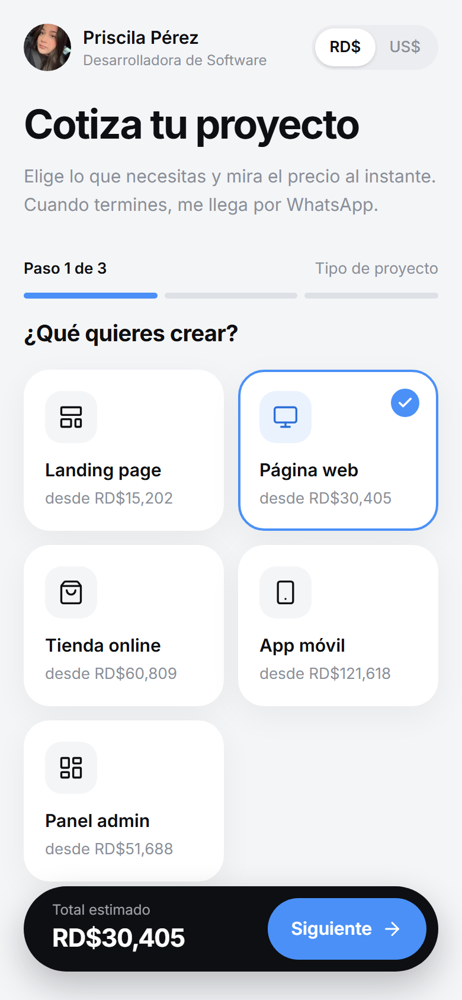
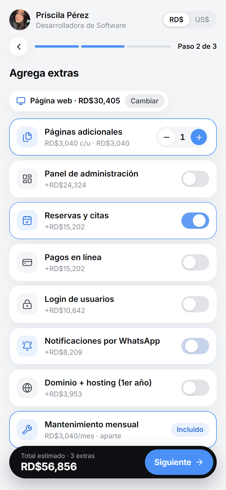
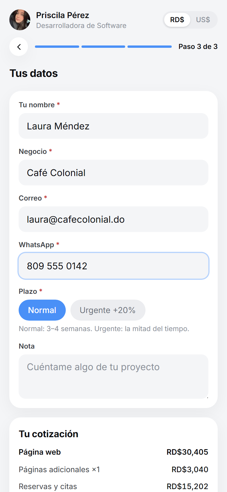

# Cotizador

**Cotizaciones, facturas y cobros para freelancers de desarrollo de software.**
Tus clientes arman su proyecto, ven el precio al instante en US$ o RD$ y te lo envían por WhatsApp.
Tú lo conviertes en cotización, factura y abonos desde un panel privado.

**Pruébalo:** [cotizador-priscila.vercel.app](https://cotizador-priscila.vercel.app)

[](https://github.com/codesbypriscila/cotizador/actions/workflows/ci.yml)


</div>

<p align="center">
  
  &nbsp;
  
  &nbsp;
  
</p>

## Qué hace

### Para tus clientes: el cotizador público (`/`)

- Eligen el tipo de proyecto (landing, página web, tienda online, app móvil, panel admin…) y marcan extras: páginas adicionales, reservas, pagos en línea, login, notificaciones por WhatsApp, dominio y mantenimiento.
- **El total se suma en vivo**, en **US$ o RD$**. Los pesos son la conversión exacta de los dólares con la tasa del día.
- Escogen el plazo (normal o urgente +20 %) y escriben su nombre y su negocio. Ambos son obligatorios y se validan: el nombre solo acepta letras.
- Con **"Enviar propuesta por WhatsApp"**, la propuesta se guarda en tu panel y se abre WhatsApp con el mensaje ya escrito hacia tu número.
- Funciona en celular (3 pasos con el total fijo abajo), iPad y computadora (todo en una página con el resumen a la derecha).

### Para ti: el panel de administración (`/admin`)

- **Inicio**: lo cobrado en el mes, lo pendiente, lo vencido y las propuestas nuevas que llegan del cotizador.
- **Cotizaciones**: editor con partidas del catálogo o libres, descuento, ITBIS 18 % y plazo urgente. Desde ahí puedes enviarlas por WhatsApp, duplicarlas o convertirlas en factura.
- **Facturas**: estados automáticos (borrador, enviada, parcial, pagada, vencida), abonos validados que nunca pasan de lo pendiente, recordatorios por WhatsApp con vista previa y descarga en PDF.
- **Clientes**: ficha con historial y saldo. **WhatsApp** abre el chat del cliente y **Correo** abre una hoja para escribirle y enviar desde tu Gmail sin salir de la app.
- **Catálogo**: tus servicios y precios **en dólares**, con el rango de mercado de referencia, el orden y la visibilidad. Es lo que ve el cliente en el cotizador.
- **Ajustes**: tu WhatsApp, la plantilla del mensaje, los datos de facturación y la tasa del dólar, que se actualiza sola cada 6 horas.

## Cómo está hecho

|            |                                                                                                                                                         |
| ---------- | ------------------------------------------------------------------------------------------------------------------------------------------------------- |
| Framework  | Next.js 16 (App Router, Server Actions, `proxy.ts`)                                                                                                     |
| Interfaz   | React 19, Tailwind CSS 4, lucide-react, fuente Inter                                                                                                    |
| Datos      | PostgreSQL en Neon con Prisma 7 (`@prisma/adapter-pg`)                                                                                                  |
| Validación | zod en el servidor y las mismas reglas en los formularios (`src/lib/validation.ts`)                                                                     |
| Login      | Una sola cuenta guardada en la base de datos (contraseña con hash scrypt) y sesión en una cookie firmada (HMAC)                                         |
| Correo     | nodemailer con Gmail (contraseña de aplicación). Las respuestas llegan a tu Gmail                                                                       |
| Moneda     | Todo se guarda en centavos de dólar. Los pesos usan la tasa de `open.er-api.com`, con respaldo en `currency-api`                                        |
| Pruebas    | Vitest (dinero, totales, mensajes, validaciones, sesión) y Playwright (flujos de cliente y admin, más una revisión responsive en 12 anchos de pantalla) |


## Correrlo en local

```bash
npm install
cp .env.example .env                       # llena las variables (ver abajo)
npx prisma dev --name cotizador            # Postgres local (o usa la URL de Neon)
npm run db:migrate
npm run db:seed                            # ajustes + catálogo de ejemplo (no borra nada)
npm run admin:set -- "tu@correo.com" "tu-contraseña"   # crea o cambia tu usuario (se guarda con hash)
npm run dev
```

| Variable         | Para qué                                                                                                                                                                 |
| ---------------- | ------------------------------------------------------------------------------------------------------------------------------------------------------------------------ |
| `DATABASE_URL`   | Conexión a Postgres. En Neon, la URL con `-pooler` y `sslmode=verify-full`                                                                                               |
| `DIRECT_URL`     | Conexión directa (sin `-pooler`) para las migraciones                                                                                                                    |
| `SESSION_SECRET` | `node -e "console.log(require('crypto').randomBytes(32).toString('base64url'))"`                                                                                         |
| `SMTP_USER`      | Tu Gmail, desde el que salen los correos a clientes                                                                                                                      |
| `SMTP_PASSWORD`  | Una [contraseña de aplicación](https://myaccount.google.com/apppasswords) de Google (no tu contraseña normal). Sin ella, la hoja de correo ofrece abrir tu app de correo |

El usuario del panel no va en variables: vive en la tabla `Admin` y se crea o cambia con `npm run admin:set`.

## Pruebas

```bash
npm test           # unitarias (Vitest)
npm run test:e2e   # de punta a punta (Playwright) contra una base local de prueba que se borra en cada corrida
```

Las pruebas de punta a punta nunca usan Neon: levantan su propia base con `prisma dev --name cotizador-e2e`.

## Publicar en Vercel

1. Importa el repositorio en Vercel.
2. Agrega las variables de entorno de arriba con las URLs de Neon (y `SMTP_*` si quieres enviar correos).
3. `vercel-build` corre las migraciones y luego el build.
4. La página pública se regenera cada hora para tomar la tasa nueva, y al momento cuando guardas el catálogo o los ajustes.

## Precios de ejemplo

El catálogo inicial trae rangos de referencia del mercado freelance en República Dominicana: Landing desde US$250, Página web desde US$500, Tienda online desde US$1,000, App móvil desde US$2,000. Todos se editan en **Admin → Catálogo**.

---

Hecho por [Priscila Pérez](https://github.com/codesbypriscila), desarrolladora de software.
